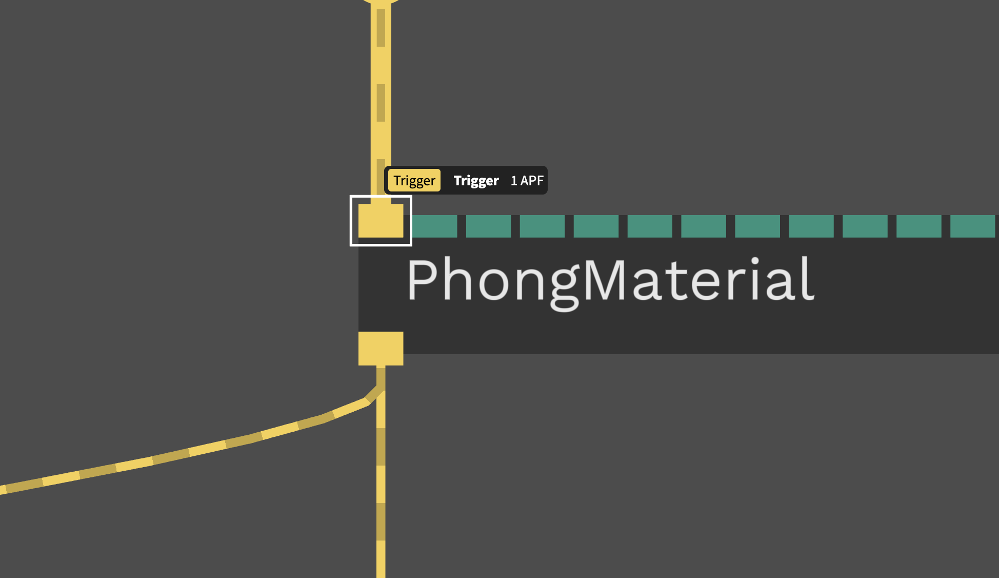
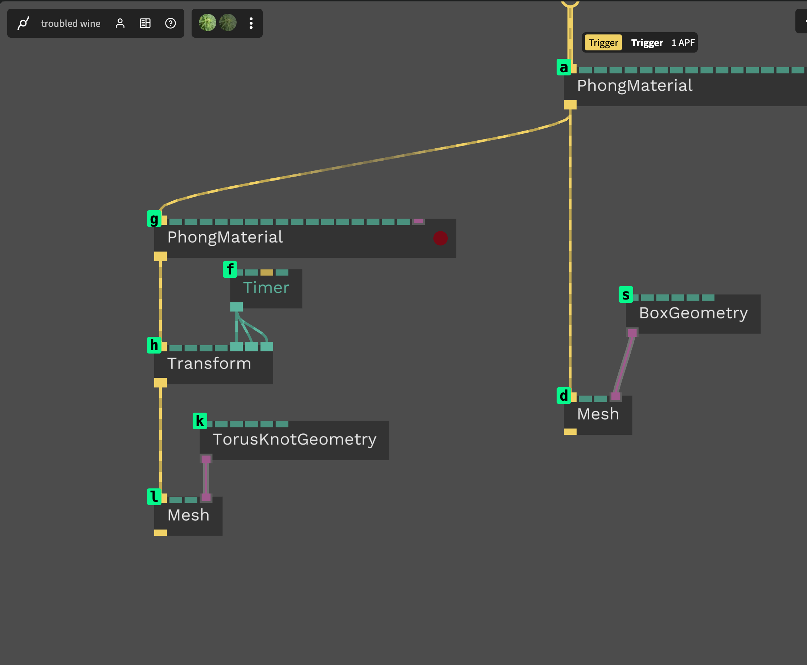

# Keyboard Navigation

## Moving the cursor

Keyboard port navigation is activated by pressing an arrow key on the patchfield.
The cursor moves from port to port.

Pressing `s` on a port activates its input field in the parameter panel, so you can enter a value directly or trigger the port.

## Adding Ops

- `a`: Add op to the currently selected port
- `i`: Insert op into the cable of the currently selected port

## Goto/Jump to Op

Press `g` `w` to jump to ops using only the keyboard.
Each op gets a jump marker. Press its character and the cursor jumps there.

## Selecting Ops

Press `enter` to select an op, press `shift + enter` to add the op to the current selection.

## Keys
- `arrowdown`: Move down
- `arrowleft`: Move left
- `arrowright`: Move right
- `arrowup`: Move up
- `enter`: Select op
- `shift + enter`: Add op to selection
- `g`: Go to: g topmost op, w jump to op, s top of branch, e bottom of branch
- `s`: Edit port in param panel
- `a`: Add op to the currently selected port
- `i`: Insert op into the cable of the currently selected port

