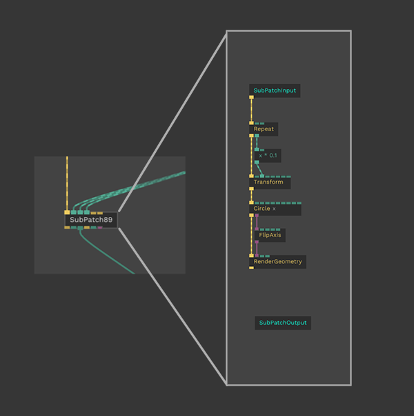
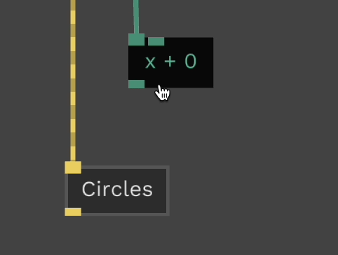
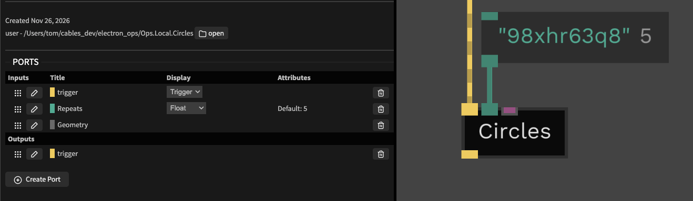

# Patching Ops / SubPatchOps

You can create new ops from existing ops. We call these subpatch ops. You can recognize them by the border around the op.

A subpatch op works like any other op: it has ports and parameters, and you can add it to a patch many times. Inside, it is a patch made of ops, not code.

## Creating a subpatch op

There are two ways:

- **From a selection:** select some ops and click "Create Op From Selection" in the right panel. The selected ops move into a new op. Links between the selected ops and the rest of the patch become ports of the new op, and stay connected.
- **Empty:** choose "Patch a new op" in the op menu. A dialog asks for the op name, and an empty subpatch op is added.

## Editing

Double-click a subpatch op to go inside. To go back Press `u` or use the breadcrumb at the top.

Every subpatch op has an input op and an output op inside. They show the op's ports from the inside.

## Ports

Ports can be added in multiple ways:

- Drag a port cable to a subpatch op, or in/output op inside and choose "createi Subpatch port"
- Inside the subpatch op, right-click a port of any op and choose "Subpatch Op: Create Port". The port is added to the subpatch op and linked to the port you clicked.
- In the op's manage tab, click "Create Port".

In the manage tab you can also edit the title, display type and default value of a port, reorder ports by dragging them, and delete them.

The subpatch op has to be saved before you can change its ports.

## Saving

All instances of a subpatch op use the same content. After saving, every instance updates. If one instance has unsaved changes and you edit another, a warning is shown: saving will overwrite the other changes.

## Using it in other patches

Patch ops only exist in their patch. To use a subpatch op in other patches, rename them to any namespace that you want. Ops.User to use it in all of YOUR patches, create a team to use them in a team namespace in shared patches etc.
